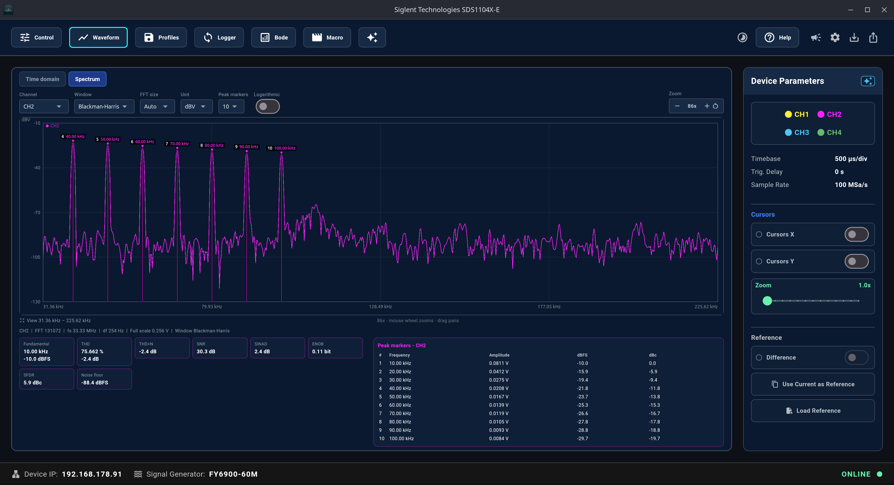

# SDS-Remote – Version 0.4.0 available

Version 0.4.0 is now available. This release introduces several new features for Time-Domain and Frequency analysis and enhanced AI-assisted operation.

**SDS-Remote** is a remote-control interface and help center for Siglent SDS1000X-E series oscilloscopes. It provides a modern graphical user interface for instrument control, waveform acquisition, screen capture, data logging, and interaction through an integrated AI-powered chat interface. SDS-Remote runs on **Linux** and **Windows**.

For a quick overview, watch the [introductory video](https://youtu.be/sbQIYpyg1p4).

---

## 1. What Is SDS-Remote?

SDS-Remote enables remote control and AI-assisted operation of the Siglent SDS1202X-E, SDS1104X-E, SDS1204X-E, and SDS1102X-E oscilloscopes from **Linux** and **Windows** systems.

### Key features

- **Remote oscilloscope control:** Control your oscilloscope remotely over a network or via USB.
- **Waveform acquisition and analysis:** Acquire and display waveform data from enabled channels, and analyze signals using the available measurement and analysis tools.
- **Device parameter monitoring:** Monitor parameters such as the timebase, sample rate, and voltage settings in real time. Cursor-based measurements and AI-assisted analysis are also supported.
- **Data logging:** Record selected measurement values over time. Generate PDF measurement reports containing charts and key metrics, or export all recorded measurement points as CSV files.
- **Signal generator and Bode plot support:** If you own a **JDS6600** or **FY6900** signal generator, you can create Bode plots using a range of parameters. You can also configure alarms and generate detailed reports.
- **Macro recorder:** Record, edit, and replay SCPI command sequences. The macro recorder supports variables, conditional statements, loops, and both network and USB connections for automated test procedures.

### Waveform data acquisition

Acquire and visualize waveform data from your oscilloscope. Use X/Y cursors and zoom controls to perform detailed measurements and analyze signals. The AI assistant can help with time-domain and frequency-domain analysis. Export waveform data as PDF reports and CSV datasets.

#### Waveform analysis


#### Spectrum analysis

Evaluate signal spectra, measure harmonic distortion, detect noise and jitter and check for electromagnetic interference.  



### Remote control panel

Capture and display oscilloscope screenshots in real time. Control your oscilloscope remotely using the virtual front panel.


### AI chat interface

Send commands and ask questions about oscilloscope functionality using natural-language prompts. You can also interact with the application and connected devices using the built-in microphone.


### Device profile management

Save and restore oscilloscope configurations using `.lss` profile files.


### Data logging

Record selected measurement values over configurable periods ranging from 1 minute to 24 hours. Track values such as frequency drift and peak-to-peak voltage variation. Generate reports containing detailed charts and start, end, minimum, and maximum values. You can also save all recorded data points to a separate CSV file.


### Signal generator support

SDS-Remote supports the widely used FY6900 and JDS6600 signal generators.

You can control a signal generator remotely using its dedicated control panel or through the AI assistants integrated into several SDS-Remote workspaces.

### Macro recorder

Record, edit, and replay SCPI command sequences to automate repetitive measurement and configuration tasks. The macro recorder supports variables, conditional statements, loops and assertions.


---

## 2. Installation

Before installing the application, make sure your oscilloscope is running the latest available firmware version.

### 2.1 Linux Debian package (`.deb`)

To install the precompiled Debian package on a Debian-based Linux distribution (for example, Ubuntu 24.04 or later), download the latest `.deb` package from the [GitHub Releases page](https://github.com/klumw/sdsremote/releases).

Install it from a terminal using the following command. Replace `[version]` with the version number in the downloaded file name:

```bash
sudo apt install ./sdsremote_[version]_amd64.deb
```

Alternatively, double-click the `.deb` file and follow the installation instructions.

After installation, you can launch SDS-Remote from your desktop environment's application menu.

### 2.2 Windows installer

On Windows, download and run the installer from the [GitHub Releases page](https://github.com/klumw/sdsremote/releases). Select the installer package provided for the release (for example, `sdsremote_[version].exe`).

---

## 3. Building the Application from Source

To build SDS-Remote from source, install the Flutter SDK and the required platform dependencies.

### 3.1 Installing Flutter and Dart

Follow the instructions for your target platform.

#### Linux

1. **Install the required dependencies.** Make sure the following development tools and libraries are installed:

   ```bash
   sudo apt install curl git unzip cmake ninja-build pkg-config libgtk-3-dev
   ```

2. **Download Flutter.** Follow the [official Flutter installation guide for Linux](https://docs.flutter.dev/get-started/install/linux).

3. **Extract Flutter and update `PATH`.** Extract the downloaded archive and add the Flutter SDK's `flutter/bin` directory to your system's `PATH`.

4. **Verify the installation.** Run the following command in a terminal to check the installation and identify any missing dependencies:

   ```bash
   flutter doctor
   ```

#### Windows

1. **Install the required dependencies:**
   - [Git for Windows](https://git-scm.com/download/win)
   - [Visual Studio 2022](https://visualstudio.microsoft.com/downloads/) with the **Desktop development with C++** workload

2. **Download Flutter.** Follow the [official Flutter installation guide for Windows](https://docs.flutter.dev/get-started/install/windows).

3. **Extract Flutter and update `PATH`.** Extract the downloaded archive and add the Flutter SDK's `flutter\bin` directory to your system's `PATH`.

4. **Verify the installation.** Run the following command in Command Prompt or PowerShell:

   ```powershell
   flutter doctor
   ```

### 3.2 Building the application

1. **Clone the repository** (if you have not already done so):

   ```bash
   git clone https://github.com/klumw/sdsremote.git
   cd sdsremote
   ```

2. **Install the project dependencies:**

   ```bash
   flutter pub get
   ```

3. **Build the Linux application:**

   ```bash
   flutter build linux
   ```

   The build output is placed in:

   ```text
   build/linux/x64/release/bundle/
   ```

4. **Build the Windows application:**

   ```bash
   flutter build windows
   ```

   The build output is placed in:

   ```text
   build/windows/x64/runner/Release/
   ```

   To run the Windows executable, make sure the required DLL files and the `data` directory are present in the same folder as the executable.

### 3.3 USB support (experimental) ⚠️

In general, a network connection to the oscilloscope is more reliable than a USB connection. USB data-transfer rates are also limited.

#### 3.3.1 USB support on Windows

For USB support on Windows, place the **x64** version of `libusb-1.0.dll` from the [libusb project](https://github.com/libusb/libusb) in the same directory as the SDS-Remote executable. The application also accepts the older file name `libusb.dll` as a fallback.

The download package contains multiple DLL versions. Select the DLL from the `/VS2025/MS64-hotplug` directory.

Next, verify that the WinUSB driver is installed for your device. If necessary, install it as follows:

1. Download the [Zadig driver tool](https://zadig.akeo.ie).
2. Connect the oscilloscope to your computer.
3. In Zadig, select **Options → List All Devices**.
4. Select the oscilloscope and install the WinUSB driver if it is not already installed.

> **Note:** If you use a VISA-based application alongside SDS-Remote, that application may no longer detect the oscilloscope after you switch its driver to WinUSB.

If SDS-Remote still does not detect the oscilloscope, check the following:

- Set **Settings → Connection Mode** to **USB (USBTMC)**.
- In Windows Device Manager, make sure the Siglent device is using the **WinUSB** driver rather than `usbtmc.sys`. If necessary, run Zadig again, select **Replace Driver**, and choose the oscilloscope's USBTMC interface.
- The WinUSB driver binding is specific to the device's VID/PID. Installing the driver for one Siglent model does not automatically cover other models. Run Zadig separately for each model. The IDs listed for the supported models are:
  - SDS1104X-E: `f4ec:ee38`
  - SDS1202X-E: `f4ed:ee3a`
- Connect to the oscilloscope's USB **Device** port, not its USB host port (which is intended for USB flash drives).
- Check the log file at `%TEMP%\sds\logging\sds.log` for messages containing `USBTMC Windows`.

#### 3.3.2 USB support on Linux

USB access is implemented using libusb, which opens the raw USB device node:

```text
/dev/bus/usb/<bus>/<device>
```

By default, this device node is accessible only to root. A udev rule is therefore required to grant the appropriate permissions. Without it, SDS-Remote may detect the oscilloscope but fail to open it, reporting an error similar to:

```text
Failed to open USB device ... Please check physical connection and USB permissions
```

Install the bundled udev rule and reload the rules:

```bash
sudo cp linux/udev/99-siglent-usbtmc.rules /etc/udev/rules.d/
sudo udevadm control --reload-rules
sudo udevadm trigger --action=change
# Unplug and reconnect the oscilloscope.
```

Verify that the device is present and that your user or group has write access:

```bash
lsusb | grep -i siglent        # e.g. f4ec:ee38 for the SDS1104X-E
ls -l /dev/bus/usb/*/*         # Check the owner and group permissions.
groups                         # Check whether your user belongs to plugdev.
```

The bundled rule covers the SDS1104X-E (`f4ec:ee38`), the SDS1202X-E (`f4ed:ee3a`), and `/dev/usbtmc*` through the `usbmisc` subsystem. For other models, add a rule using the relevant `idVendor` and `idProduct` values shown by `lsusb`.

Some Siglent USB firmware versions do not fully comply with the USB specification. To check for this issue:

1. Connect the oscilloscope to a USB port.
2. Run:

   ```bash
   sudo dmesg
   ```

3. Look for messages similar to the following:

   ```text
   config 1 interface 0 altsetting 0 bulk endpoint 0x81 has invalid maxpacket 64
   usb 1-4: config 1 interface 0 altsetting 0 bulk endpoint 0x1 has invalid maxpacket 64
   ```

If you see these messages, the device's USB firmware may not fully comply with the USB specification. As a result, some SDS-Remote features, such as profile upload, may not work correctly on Linux.

### 3.4 Running the application

You can run the application directly in development mode using Flutter.

#### Linux

```bash
flutter run -d linux
```

The Linux window title bar and taskbar use the bundled SDS-Remote icon (`assets/icons/sds-remote.png`). The GTK header bar uses a smaller 24 × 24 icon scaled from `assets/icons/sds-remote-icon_128_128.png`. Both icons are loaded and applied by the GTK runner in [`linux/runner/my_application.cc`](linux/runner/my_application.cc#L65).

#### Windows

```powershell
flutter run -d windows
```

### 3.5 Running the test suite

Run the unit and widget tests from the project root:

```bash
flutter test
```

The AI search-accuracy evaluation in `test/ai_search_accuracy_test.dart` makes real API calls: one search-agent call and one grader call per test case. The LLM under test is configured in the test itself (currently `edenai:mistral-code-agent-latest`, which also powers its knowledge-base search sub-agent). The grader LLM is currently `deepseek:deepseek-v4-flash`.

You must export API keys for both providers. Run the test from the project root so that the relative paths to `test/ai_test_data.json` and `docs/knowledgebase.md` resolve correctly:

```bash
export EDENAI_API_KEY="..."
export DEEPSEEK_API_KEY="sk-..."
flutter test -r expanded test/ai_search_accuracy_test.dart
```

The `-r expanded` reporter displays the score and reasoning for each test case. A full run evaluates 20 cases and may take several minutes. The average results are printed and written to `test/ai_search_accuracy_results.json`.

---

## 4. AI Configuration

The AI chat feature supports the following providers:

- DeepSeek
- OpenAI
- Anthropic
- Google
- Mistral
- Cohere
- EdenAI
- OpenRouter
- xAI

### Model names

The application does not ship a fixed model catalog. The built-in agents use `deepseek-v4-flash` as their default DeepSeek model. Enter that identifier in the **LLM Model** field for the default configuration.

For other providers, use the exact model identifier from the provider's current documentation. The application passes the entered name to the selected provider.

> **Warning:** The AI subsystem may produce inaccurate information or incorrect operating instructions. Use AI-generated information at your own risk, and verify AI-generated instructions before applying them to your equipment.

---

## 5. License and Feedback

### License

This software is released under the terms and conditions of the [Apache License, Version 2.0](https://www.apache.org/licenses/LICENSE-2.0.html).

### Feedback and support

- Consult the in-app help manual for troubleshooting guidance.
- Before reporting an issue, check the application log:
  - **Linux:** `/tmp/sds/logging/sds.log`
  - **Windows:** `%TEMP%\sds\logging\sds.log`
- Submit bug reports and feature requests through the [SDS-Remote GitHub Issues page](https://github.com/klumw/sdsremote/issues).

> **Note:** This application is not affiliated with Siglent or any other commercial entity.
