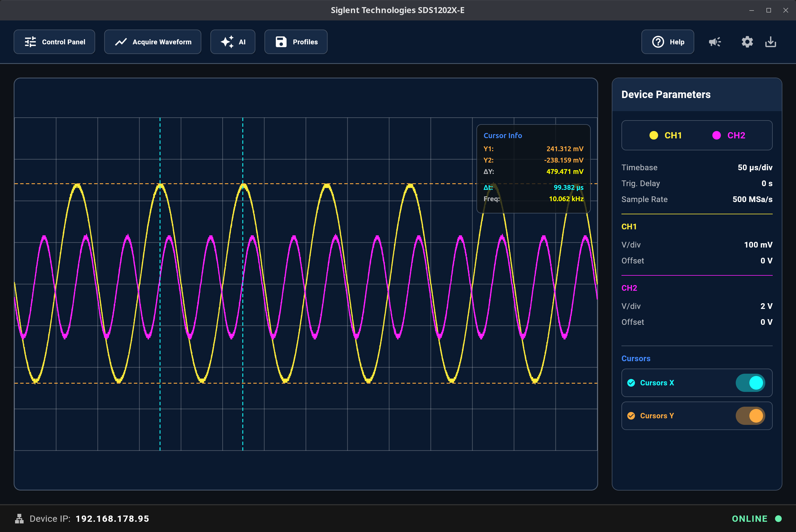
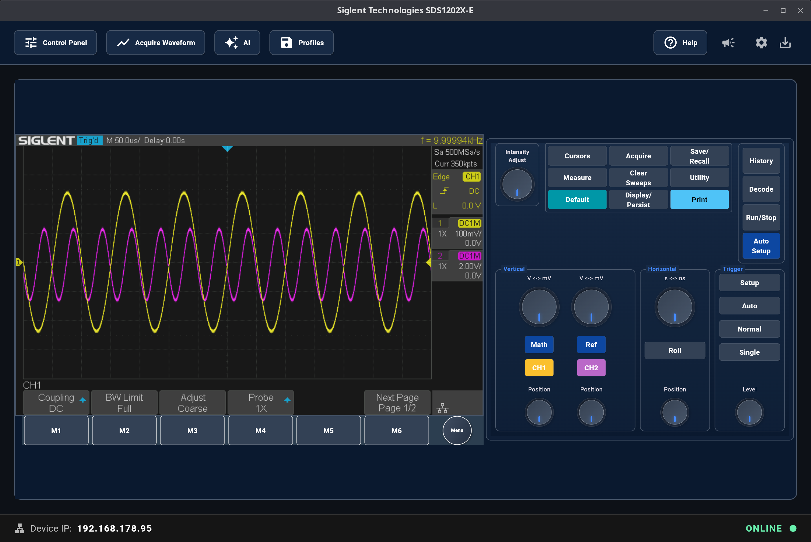
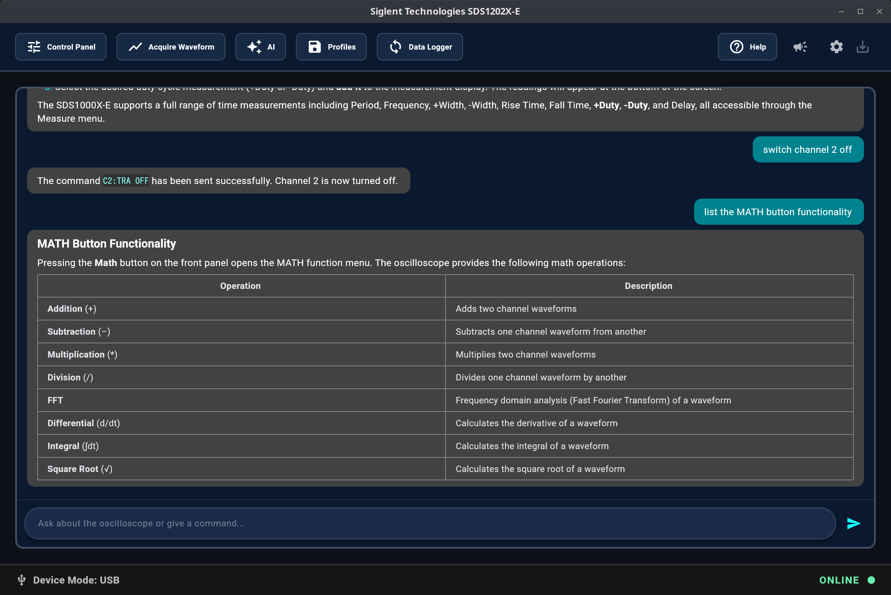
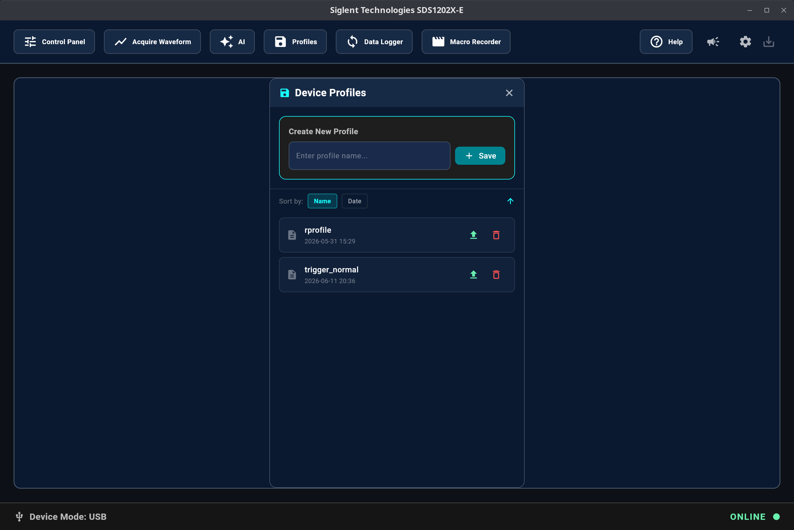
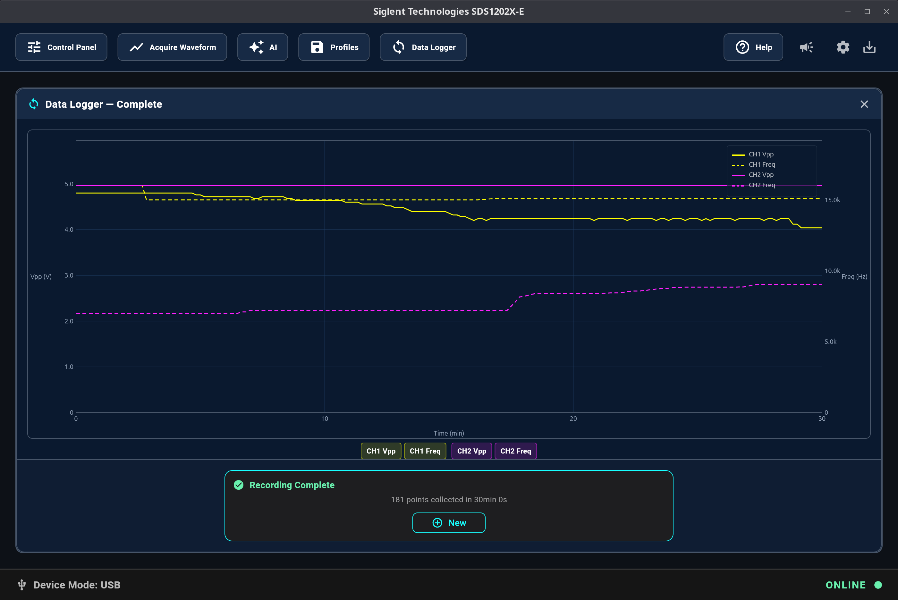
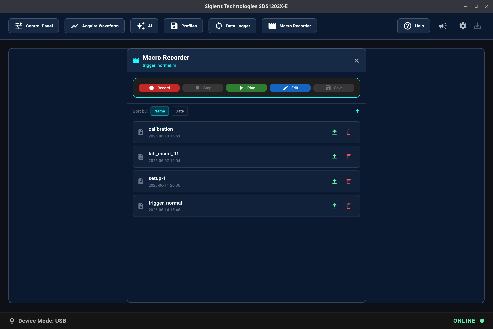

# SDS-Remote

**SDS-Remote** is a remote control interface and help center for Siglent SDS 1000X-E series oscilloscopes. It provides a modern graphical user interface (GUI) for instrument control, waveform acquisition, screen capture, data logging, and interaction through an integrated AI-powered chat interface. SDS-Remote runs on **Linux** and **Windows**.  For a quick overview, watch the [introductory video](https://youtu.be/sbQIYpyg1p4).

> **Note:** This application is not affiliated with Siglent or any other commercial entity.

---

## 1. What is SDS-Remote and What It Can Do?

SDS-Remote enables remote control and AI-enhanced operation of Siglent SDS1202X-E, SDS1104X-E, SDS1204X-E, and SDS1102X-E oscilloscopes from **Linux** and **Windows**.

### Key Features

- **Remote Oscilloscope Control**: Control supported oscilloscopes remotely over a network using the VXI-11 protocol or through USB connectivity (USB support is currently experimental).
- **Waveform Acquisition & Data Export**: Capture and display waveform data from enabled channels. Save screen captures as images and export waveform data as CSV files.
- **Device Parameter Monitoring**: View real-time parameters such as timebase, sample rate, and voltage settings. Cursor-based measurements are supported.
- **Data Logging**: Log key data points over a period of time. Generate PDF measurement reports containing charts and key metrics, or export all recorded measurement points as CSV files.
- **Signal Generator & Bode Plot**: Choose **No Signal Generator**, **JDS6600** or **FY6900** in the settings. With JDS6600 or FY6900 selected, a **Bode** toolbar button appears once both the oscilloscope and the generator are detected; it runs a frequency sweep and plots gain and phase. The sweep limits are taken from the detected generator model and the selected waveform.
- **Macro Recorder**: Record, edit and play back SCPI command sequences. Supports variables, conditionals, loops, and both network and USB connections for automated test procedures.

### Waveform Data Acquisition

Acquire and visualize waveform data. Perform advanced measurements using X/Y cursors and zoom controls for detailed waveform analysis. Export waveform data as image files or CSV datasets.



### Remote Control Panel

Acquire and display oscilloscope screenshots in real time. Control your oscilloscope remotely using a virtual front panel.



### AI Chat Interface

Send commands and query oscilloscope functionality using natural-language prompts.

The instrument sub-agent also exposes a deterministic measurement parser tool
(`parse_measurement`). It converts raw `PAVA` response strings such as
`C1:PAVA PKPK,3.000000E+00V` or `C1:PAVA FREQ,9.998900E+02Hz` into a structured
result (`channel`, `measurement`, `value`, `unit`) plus a human-readable form
(`3 V`, `1.5 kHz`, ...). Parsing and unit conversion are pure code — no LLM is
involved — and invalid input is rejected with a structured error instead of
producing a wrong value.



### Device Profile Management

Save and restore oscilloscope configurations using local `.lss` profile files.



### Data Logging

Log key measurement data over configurable durations ranging from 1 minute to 24 hours. Measure frequency drift and peak-to-peak voltage variations and generate reports with a detailed diagram, start/end and min/max values. All data points can also be saved in a separate CSV file.



### Signal Generator Selection

**Settings → Signal Generator** contains a dropdown with three entries:

- **No Signal Generator** (default)
- **JDS6600** (JOY-IT/Juntek JDS6600 and JDS6600-Lite)
- **FY6900** (FeelElec FY6900; Bode plot, port detection and signal-generator
  window)

The selection is persisted as `siggen_device`. The app scans the serial ports,
identifies the configured generator via the SCPI identity (`*IDN?`) and shows a
**Bode** button once the oscilloscope is online and the generator is detected.
The JDS6600 identifies as `JOY-IT,JDS6600-…`; the FY6900 as
`FeelElec,FY6900-…`.

The **Bode Plot** panel follows the Data Logger layout and supports start/stop
frequency, point count, logarithmic/linear spacing, amplitude, offset,
waveform, settling time, optional phase measurement and selectable input/output
channels (default CH1 = Vin, CH2 = Vout). It sweeps the configured signal
generator (JDS6600 or FY6900), measures RMS
voltages and phase with the Siglent, computes gain in dB and phase in degrees,
and shows two aligned plots with a shared logarithmic frequency axis. The
configuration mask has an optional **Report Name** field; the top-bar Save
action captures the plot and writes a PDF report with the report name, the
plot image and the sweep configuration to `bode/reports/` (the sweep data is
additionally written as CSV when *Save csv data* is enabled).

Start/stop frequency, amplitude and offset limits are derived from the detected
generator model and the selected waveform (for example a FY6900-30M sine sweep
is limited to 30 MHz, a FY6900-60M to 60 MHz). The configuration form shows the
active model limits.

Signal wiring: generator CH1 → DUT input → scope CH1; DUT output → scope CH2.
The generator outputs are switched off when a sweep finishes, fails or is
cancelled. Phase uses the Siglent `MEAD PHA` measurement with the documented
`C1-C2:MEAD? PHA` query, plus a waveform-crossing fallback and a ±180°
plausibility check. The scope returns the input relative to the output, so the
sign is inverted; an RC low-pass was used to verify that a lagging output is
shown as a negative phase. Transient scope acquisitions in which Vin collapses
to the noise floor are retried; if the reading stays implausible, the point is
marked invalid and left out of the plot instead of appearing as a spike. The
output channel's V/div is adjusted automatically when the signal is too small
or too large for the current scale; below about −30 dB the phase is taken from
the waveform crossings because the scope's MEAD measurement is noise-limited.

The signal-generator backend lives in `lib/src/signal_generator/`: the shared
service, SCPI layer and `SiggenDriver` seam, the JDS6600 register codec, and
the FY6900 command codec (`fy6900_protocol.dart` / `fy6900_driver.dart`). Both
drivers offer the same SCPI command syntax (`SOURce<n>:FREQ`, `VOLT`, `PHAS`,
`OUTP<n>:STAT`, …). The Bode logic lives in `lib/src/bode/`. A hardware check
for the JDS6600 is still available:

```bash
flutter build linux --debug
LIBSERIALPORT_PATH="$PWD/build/linux/x64/debug/bundle/lib" \
  dart run test/jds6600_check.dart /dev/ttyUSB0
```

The script saves registers 20-31, sets CH1 to a known signal, verifies the
readback and restores the previous state. On Windows, point
`LIBSERIALPORT_PATH` at the directory containing `serialport.dll` next to the
built runner. On Linux the user must be in the `dialout` group; on Windows the
CH340 driver must be installed.

### Signal Generator Window (Ctrl+J)

With **Signal Generator → JDS6600** or **FY6900** selected and the generator
detected, press **Ctrl+J** to open a separate OS window (there is no toolbar
button). Pressing Ctrl+J again focuses the existing window. The window offers
the two channel views **CH1 / CH2** with waveform, frequency (Hz/kHz/MHz),
amplitude (Vpp), DC offset, duty cycle (effective for square/pulse on the
JDS6600 and square/rectangle on the FY6900), phase
(global CH2-vs-CH1 on the JDS6600, per-channel phase on the FY6900) and an
immediate
output on/off switch. Other values are applied explicitly with **Apply
changes**; confirmed device values and pending edits are shown separately.
Frequency and amplitude limits come from the model returned by the driver
identity query (JDS6600-LITE/JDS6600 or FY6900-20M…FY6900-100M) and the
selected waveform; offset, duty-cycle and phase ranges are derived from the
same detected device family. Numeric values can be adjusted with spinner
buttons next to the fields.

All hardware access stays in the main window; the second window only sends
typed commands through a bridge. Settings cannot be changed while a Bode sweep
is running, and the child window closes together with the main application.

### Macro Recorder

Record, edit and play back SCPI command sequences to automate repetitive measurement and configuration tasks. Supports variables, conditionals (`if`/`else`), loops (`while`), assertions, and both network (`connect("IP")`) and USB (`connect(usb)`) connections.

> ⚠️ USB connection support in macros is experimental.


---

## 2. Installation

### 2.1 Linux Debian `.deb` Package

To install the precompiled Debian `.deb` package on Debian-based Linux distributions (for example, Ubuntu 24.04 or newer), download the [latest package](https://github.com/klumw/sdsremote/releases) from the Releases page and run the following command in your terminal:

```bash
sudo apt install ./sdsremote_[version]_amd64.deb
```

Alternatively, double-click the `.deb` file and follow the installation instructions.

Once installed, you can launch the application from your desktop environment's application menu.

---

### 2.2 Windows MSI Installer

For Windows installation, use the MSI installer: [sdsremote_[version].exe](https://github.com/klumw/sdsremote/releases)

---

## 3. Building the Application Yourself

If you prefer to build SDS-Remote from source, you will need to install the Flutter SDK and its dependencies.

### 3.1 Installing Flutter/Dart

Choose the instructions for your target platform.

#### Linux

1. **Install Dependencies**: Ensure the required development tools are installed:

   ```bash
   sudo apt install curl git unzip cmake ninja-build pkg-config libgtk-3-dev
   ```

2. **Download Flutter**: Download the Flutter SDK from the [official Flutter Linux installation guide](https://docs.flutter.dev/get-started/install/linux).

3. **Extract and Add to PATH**: Extract the archive and add the `flutter/bin` directory to your system `PATH`.

4. **Verify Installation**: Run `flutter doctor` in your terminal to verify that all dependencies are installed and the environment is configured correctly.

#### Windows

1. **Install Dependencies**: Ensure the following components are installed:

   - [Git for Windows](https://git-scm.com/download/win)
   - [Visual Studio 2022](https://visualstudio.microsoft.com/downloads/) with the **Desktop development with C++** workload

2. **Download Flutter**: Download the Flutter SDK from the [official Flutter Windows installation guide](https://docs.flutter.dev/get-started/install/windows).

3. **Extract and Add to PATH**: Extract the archive and add the `flutter\bin` directory to your system `PATH`.

4. **Verify Installation**: Run `flutter doctor` in a command prompt to verify that all dependencies are installed and the environment is configured correctly.

### 3.2 Building the App from Source

1. **Clone the Repository** (if not already cloned):

   ```bash
   git clone https://github.com/klumw/sdsremote.git
   cd sdsremote
   ```

2. **Install Packages**:

   ```bash
   flutter pub get
   ```

3. **Build the Linux Application**:

   ```bash
   flutter build linux
   ```

   The compiled executable will be located in the `build/linux/x64/release/bundle/` directory.

4. **Build the Windows Application**:

   ```bash
   flutter build windows
   ```

   The compiled executable will be located in the `build/windows/x64/runner/Release/` directory.

   To run the executable, ensure that the associated DLLs and the data directory are located in the same folder.

### 3.3 USB Support (Experimental) ⚠️

#### 3.3.1 USB Support on Windows

For USB support on Windows, place `libusb.dll` from the [libusb project](https://github.com/libusb/libusb) in the same directory as the SDS-Remote executable.

Multiple DLL versions are available in the download package. Select the DLL located under `/VS2025/MS64-hotplug`.

Next, verify or install the WinUSB driver for your device:

1. Download the [Zadig](https://zadig.akeo.ie) driver tool.
2. Connect your device.
3. In Zadig, enable **Options → List All Devices**.
4. Select your device and install the WinUSB driver if it is not already installed.

> Note: If you are using a VISA-based application in parallel, it may no longer detect the device after switching to the WinUSB driver.

#### 3.3.2 USB Support on Linux

Some Siglent USB firmware versions are not fully USB compliant. Perform the following compatibility check:

1. Connect your device to a USB port.
2. Run the following command:

   ```bash
   sudo dmesg
   ```

3. If you see messages similar to the following:

   ```bash
   config 1 interface 0 altsetting 0 bulk endpoint 0x81 has invalid maxpacket 64
   usb 1-4: config 1 interface 0 altsetting 0 bulk endpoint 0x1 has invalid maxpacket 64
   ```

   then the device's USB firmware is not fully compliant with the USB standard, and some SDS-Remote functionality, such as profile upload, may not work correctly under Linux.

### 3.4 Running the Application

You can run the built executable directly or start the application in debug/development mode.

#### Linux

```bash
flutter run -d linux
```

The Linux window title bar and task bar show the bundled SDS-Remote icon
(`assets/icons/sds-remote.png`). The GTK header bar (top bar) uses a small 24x24
icon scaled from `assets/icons/sds-remote-icon_128_128.png`. Both icons are
loaded and applied by the GTK runner in
[`linux/runner/my_application.cc`](linux/runner/my_application.cc:65).

#### Windows

```bash
flutter run -d windows
```

### 3.5 Running the Test Suite

Run the unit and widget tests from the project root:

```bash
flutter test
```

The AI search accuracy evaluation in `test/ai_search_accuracy_test.dart` performs
real API calls — one search-agent call plus one grader call per test case. The
LLM under test is configured in the test itself (currently
`edenai:mistral-code-agent-latest`, which also drives its knowledgebase search
sub-agent), while the grader LLM is currently `deepseek:deepseek-v4-flash`.
Both provider keys must therefore be exported. Run the test from the project
root so that the relative paths to `test/ai_test_data.json` and
`docs/knowledgebase.md` resolve:

```bash
export EDENAI_API_KEY="..."
export DEEPSEEK_API_KEY="sk-..."
flutter test -r expanded test/ai_search_accuracy_test.dart
```

The `-r expanded` reporter shows the per-case score and reasoning. A full run
evaluates 20 cases and can take several minutes; the averaged results are printed
and written to `test/ai_search_accuracy_results.json`.

---

## 4. AI Configuration

The AI chat feature supports the following providers:

| Provider |
| --- |
| DeepSeek |
| OpenAI |
| Anthropic |
| Google |
| Mistral |
| Cohere |
| EdenAI |
| OpenRouter |
| xAI |

The following LLMs are known to work with the application:

### Known working models

- deepseek-flash
- gpt-6-luna
- gemini-flash
- claude-sonnet
- qwen-3.x-max
- mistral-code

*For exact model names, refer to your provider's documentation.*

> The AI subsystem may generate inaccurate information or incorrect operating instructions. Use this functionality at your own risk.

### AI Subsystem Code Layout

The AI code is split into agents and tools:

- `lib/src/ai/agents/` — agent classes and system prompts:
  - `frontend_agent.dart` — user-facing agent that delegates to specialized sub-agents.
  - `instrument_agent.dart` — SCPI/VXI-11 instrument control agent.
  - `search_agent.dart` — knowledgebase search agent.
  - `max_tool_calls_handler.dart` — shared max-tool-call mixin used by agents.
  - `systemprompts.dart` — centralized system prompt strings for all agents.
- `lib/src/ai/tools/` — all agent tools:
  - `vxi11_tool.dart` — raw SCPI write/query tool for the instrument.
  - `measurement_tool.dart` — deterministic PAVA measurement parser (`parse_measurement`).
  - `scpi_agent_tool.dart` — wraps the instrument agent as a `scpi_instrument_agent` tool.
  - `search_agent_tool.dart` — wraps the search agent as a `search_agent` tool.
  - `knowledgebase_search_tool.dart` — knowledgebase chunk search tool (`knowledgebase_search`).

### Widget Code Layout

All Flutter widget class files live under `lib/src/widgets/`:

- Panels: `data_logger_panel.dart`, `macro_editor_panel.dart`,
  `macro_recorder_panel.dart`, `osci_device_params_panel.dart`,
  `osci_physical_panel.dart`, `osci_profiles_panel.dart`,
  `osci_settings_panel.dart`, `bode_plot_panel.dart`,
  `signal_generator_panel.dart`.
- Windows/screens: `home_page.dart`, `osci_chat_window.dart`,
  `osci_help_window.dart`, `signal_generator_window.dart`.
- Widgets & dialogs: `data_logger_dialog.dart`, `data_logger_plot.dart`,
  `osci_knob_widgets.dart`, `osci_news_notification.dart`,
  `osci_toolbar_button.dart`, `filename_prefix_dialog.dart`,
  `reference_file_picker_dialog.dart`, `unsaved_changes_dialog.dart`.

Non-widget, domain-specific support code is grouped into subfolders under
`lib/src/`.

### Domain Code Layout

- `lib/src/ai/` — AI agents (`agents/`), tools (`tools/`), and the chat service
  (`ai_chat_service.dart`).
- `lib/src/app/` — application configuration and environment:
  `app_config.dart`, `app_paths.dart`, `app_preferences.dart`, `app_theme.dart`.
- `lib/src/core/` — cross-cutting utilities: `logger.dart`.
- `lib/src/data_logger/` — Data Logger logic: `data_logger_csv_writer.dart`,
  `data_logger_models.dart`, `data_logger_report.dart`, `data_logger_service.dart`.
- `lib/src/instrument/` — instrument I/O and protocol: `dart_vxi11.dart`
  (VXI-11/USBTMC transport), `scpi_parser.dart` (SCPI response parsing),
  `measurement.dart` (PAVA measurement parsing/formatting).
- `lib/src/signal_generator/` — signal-generator domain layer shared by both
  families: `models.dart` (identity and limits), `siggen_driver.dart` (driver
  seam), `jds6600_protocol.dart` (register codec), `jds6600_driver.dart`,
  `fy6900_protocol.dart` (command codec), `fy6900_driver.dart`,
  `jds6600_transport.dart` (transport seam), `jds6600_serial_transport.dart`
  and `fy6900_serial_transport.dart` (libserialport backends),
  `serial_port_info.dart` (port discovery), `siggen_scpi.dart` (SCPI subset)
  and `signal_generator_service.dart` (connection, cache, queue, polling).
  The Ctrl+J window adds `siggen_window_protocol.dart` (bridge DTOs),
  `siggen_window_host.dart` / `siggen_window_launcher.dart` /
  `siggen_window_server.dart` (main-window side) and
  `siggen_window_client.dart` / `siggen_window_controller.dart`
  (child-window side).
- `lib/src/bode/` — Bode Plot domain and sweep: `bode_models.dart`,
  `bode_math.dart`, `bode_scope.dart`, `vxi11_bode_scope.dart`,
  `waveform_phase.dart`, `bode_plot_service.dart`, `bode_csv_writer.dart`,
  `bode_report.dart`.
- `lib/src/macro/` — Macro language and recorder logic: `macro_ast.dart`,
  `macro_evaluator.dart`, `macro_grammar.dart`, `macro_lint_controller.dart`,
  `macro_lint_error.dart`, `macro_linter.dart`, `macro_recorder_models.dart`.
- `lib/src/waveform/` — Waveform models, conversion, acquisition, and rendering:
  `waveform_models.dart`, `waveform_converter.dart`, `waveform_acquisition.dart`,
  `waveform_painter.dart`, `cursor_geometry.dart`, plus the CSV/processing
  helpers `waveform_csv_parser.dart`, `waveform_csv_writer.dart`,
  `waveform_processing.dart` (drops the first 8 acquisition samples, which
  contain a transient artifact visible as a left-edge offset in the plot).
  Voltage conversion uses `V = code * vdiv / 25 - OFST` (Siglent `OFST` is the
  zero-level offset from screen center), and the painter centers the visible
  range at `-OFST`.
- `lib/src/widgets/` — all Flutter widget classes (see Widget Code Layout).

The application entry point `main.dart` stays at `lib/`.

---

## 5. License and Feedback

### License

This software is released under the terms and conditions of the [Apache 2.0 License](https://www.apache.org/licenses/LICENSE-2.0.html).

### Feedback and Support

- Review the in-app help manual for troubleshooting guidance.
- Check the application logs at:
  - Linux: `/tmp/sds/logging/sds.log`
  - Windows: `%TEMP%\sds\logging\sds.log`
- Submit issues or feature requests through the [SDS-Remote GitHub Issues page](https://github.com/klumw/sdsremote/issues).