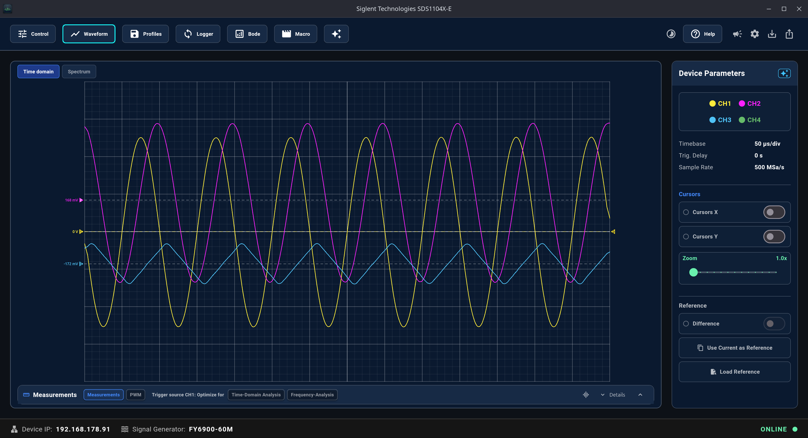
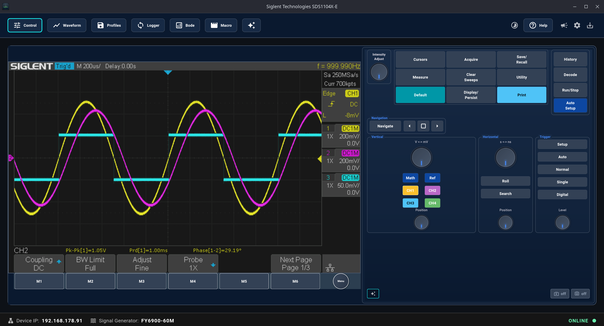
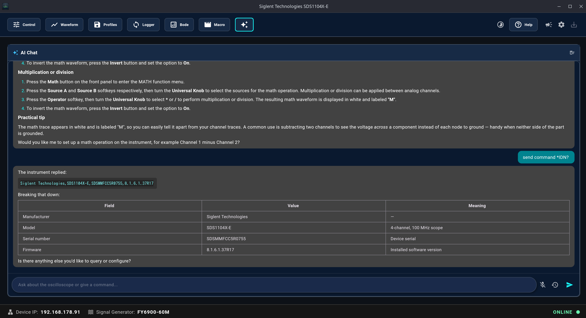
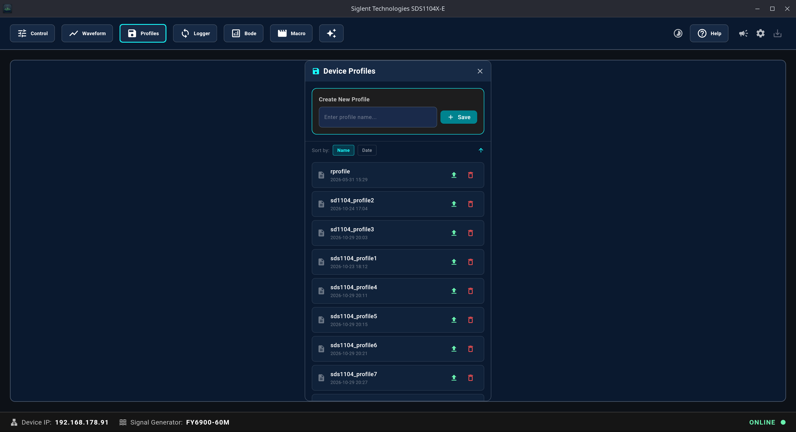
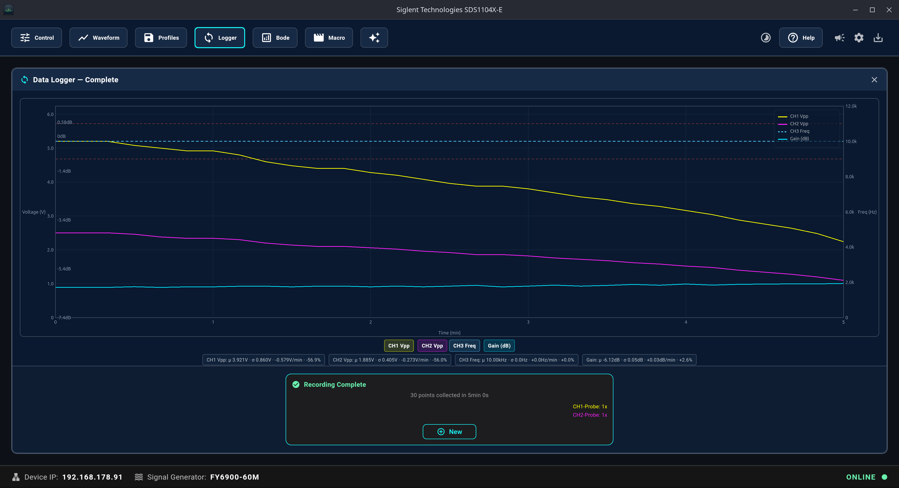
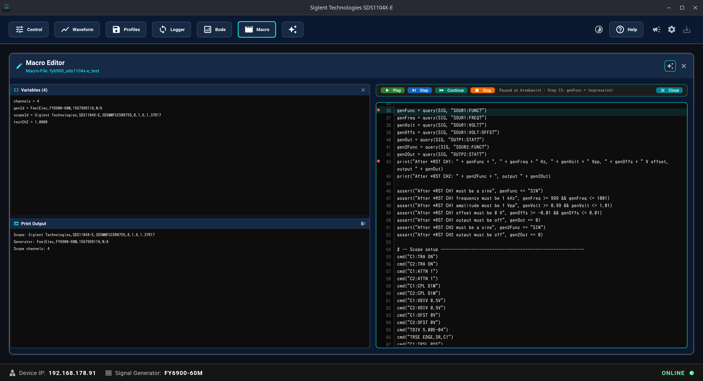

# SDS-Remote - New version 0.3.0 available
The new version is out, now with better support for 4-channel oscilloscopes, Bode plot support for non Siglent Signal Generators and much more!  

**SDS-Remote** is a remote control interface and help center for Siglent SDS 1000X-E series oscilloscopes. It provides a modern graphical user interface (GUI) for instrument control, waveform acquisition, screen capture, data logging, and interaction through an integrated AI-powered chat interface. SDS-Remote runs on **Linux** and **Windows**.  For a quick overview, watch the [introductory video](https://youtu.be/sbQIYpyg1p4).

> **Note:** This application is not affiliated with Siglent or any other commercial entity.

---

## 1. What is SDS-Remote and What It Can Do?

SDS-Remote enables remote control and AI-enhanced operation of Siglent SDS1202X-E, SDS1104X-E, SDS1204X-E, and SDS1102X-E oscilloscopes from **Linux** and **Windows**.

### Key Features

- **Remote Oscilloscope Control**: Control supported oscilloscopes remotely over a network using the VXI-11 protocol or through USB connectivity (USB support is currently experimental).
- **Waveform Acquisition & Data Export**: Capture and display waveform data from enabled channels. Save screen captures as images, write waveform PDF measurement reports and CSV data, and export waveforms as LTspice PWL, WAV or VCD files (or copy the measurement table to the clipboard). A **Spectrum** tab shows the windowed FFT of every acquired channel as overlaid or single-channel traces with selectable window, FFT size and level unit, automatic peak markers and THD, THD+N, SNR, SINAD, ENOB and SFDR metrics, and exports the spectrum as CSV. A **Waveform AI** assistant (sparkle button in the Device Parameters header) analyses the current measurements and spectrum with deterministic math tools and date/time access, and can query or change the oscilloscope through the instrument agent after explicit confirmation. When the request contains **Signalgenerator** or one of its aliases (Signalgeber, Funktionsgenerator, Frequenzgenerator, Testsignalgenerator, Prüfsignalgenerator, Signalquelle, Signal Generator, Signal Source, Function Generator, Frequency Generator, Waveform Generator, Test Signal Generator, Signal Synthesizer, SignalGen, siggen, WaveGen), for example "Signalgenerator Frequenz Kanal 1 10 kHz", it also controls the connected JDS6600/FY6900 signal generator: channel 1/2, frequency, amplitude, offset, waveform, duty, phase, output on/off, device limits, reset and stop. A message that starts with **Scope**, **Oscilloscope**, **Oszi** or **Oszilloskop** is an explicit oscilloscope command; the keyword counts as confirmation, so the requested setting is applied immediately instead of being proposed first. The PDF measurement report includes the same spectrum analysis per channel.
- **Intelligent Waveform Analysis**: An **Analysis** tab (visible when the app is started with the explicit `--debug` flag) classifies the captured waveform against ten mathematical reference signals (sine, square, triangle, sawtooth, pulse, exponential decay, damped oscillation, clipped sine, noisy sine and PWM). The engine extracts time-domain, frequency-domain, shape and differential sign features, compares the capture with parameter-matched references using normalised cross-correlation, banded DTW, spectral comparison and weighted feature comparison, and combines the results into a 0–100 % similarity score with a confidence band. The differential sign statistics of the first and second differences follow Xiao et al., *Electronics* 2026, 15(17), 4044, and keep sine, square, triangle and sawtooth apart at oscilloscope 8-bit resolution. It reports the top three matches, the complete feature set, secondary characteristics and anomalies (noise, clipping, overshoot/undershoot, ringing, jitter, missing pulses, DC offset, harmonic distortion, duty instability), and overlays the capture with the best reference and the difference trace. Uncertain and mixed signals are reported as unknown instead of being forced into a category. The same engine is exposed to the Waveform AI Assistant through `classify_waveform`, `compare_waveform_to_references`, `compare_waveforms`, `get_waveform_features`, `generate_reference_waveform`, `analyze_waveform_faults`, `manage_fault_analysis_profile` and `read_logic_level_reference`, so the agent bases its explanations on real analysis results.
- **Device Parameter Monitoring**: View real-time parameters such as timebase, sample rate, and voltage settings. Cursor-based measurements are supported.
- **Data Logging**: Log key data points over a period of time. Generate PDF measurement reports containing charts, key metrics, per-parameter statistics and alarm events, or export all recorded measurement points as CSV files. Optional lower/upper alarm rules per parameter raise one event per threshold crossing; threshold lines and event markers are drawn in the plot.
- **Analysis Tools**: A ripple/noise preset measures AC-coupled, bandwidth-limited supply noise and restores the previous channel settings. Clock detection recognises a stable 50 % clock and suggests the matching 1-2-5 timebase. Timelapse mode captures the screen into a timestamped folder at a fixed interval. The measurement cards explain every metric with an offline info text.
- **Signal Generator & Bode Plot**: Choose **No Signal Generator**, **JDS6600** or **FY6900** in the settings. With JDS6600 or FY6900 selected, a **Bode** toolbar button appears once both the oscilloscope and the generator are detected; it runs a frequency sweep and plots gain and phase. The sweep limits are taken from the detected generator model and the selected waveform. The completed sweep is analysed automatically: peak gain/frequency, −3 dB frequency, bandwidth, Q factor and 0 dB crossover, with markers in the gain plot and a table in the PDF report. A toggle in the configuration form decides whether the generator outputs are switched off after the sweep (default) or stay on at the last frequency.
- **Macro Recorder**: Record, edit and play back SCPI command sequences. Supports variables, conditionals, loops, and both network and USB connections for automated test procedures.
- **Engineering Calculator**: A scientific/programmable calculator window (Ctrl+R) with unit-aware expressions, complex numbers, dB level arithmetic, electronics/RF/audio/digital formulas, variables, programs, history and export.
- **AI Control Panel Assistant**: Configure the oscilloscope from the Control Panel in plain language. The assistant overlays the control sidebar, reads the connected model and channel count, and delegates the SCPI work to the instrument agent.
- **AI Chat Signal Generator Control**: When a JDS6600 or FY6900 is configured and connected, the AI Chat's orchestrator agent controls the generator when the request contains **Signalgenerator** or one of its aliases (Signalgeber, **Generator** (AI Chat only), Funktionsgenerator, Frequenzgenerator, Signalquelle, Function Generator, WaveGen and others), for example "Signalgenerator Frequenz Kanal 1 10 kHz": channel 1/2, frequency, amplitude, offset, waveform, duty, phase, output on/off, status including device limits, reset and stop. Without the keyword the generator is never touched.
- **In-App Help Center**: The Help window opens the manual in a searchable view with a table of contents and link history. A floating button in the bottom-right corner jumps back to the top of the text at any time.
- **Assistant Voice Input**: The main AI Chat and the Control Panel, Waveform, Macro Recorder and Help AI Assistants each have a microphone button next to their input field. It is always off when an assistant opens; pressing it starts continuous listening and every utterance is transcribed locally with whisper.cpp (multilingual **base** model, ~142 MB, downloaded on first use) and sent to that assistant as a chat message. Listening continues until the button is pressed again, the assistant closes, or its main panel is left (for example switching from AI Chat to the Control Panel), and the capture pauses while the assistant answers. Animated audio bars in the top bar show when the microphone is active. The former central microphone, the "Hey Assistant" wake word and the AI App-Agent have been removed. Short commands such as **Aufnahme**, **record**, **update** or **snapshot** read a fresh waveform in the Waveform AI assistant and fetch a new screen dump in the Control Panel AI assistant, without an AI model round trip. Transcripts are written to the application log.

### Waveform Data Acquisition

Acquire and visualize waveform data. Perform advanced measurements using X/Y cursors and zoom controls for detailed waveform analysis. Export waveform data as PDF measurement reports or CSV datasets. Exported CSV files use the actual sample timestamps of the displayed points (format version 2), so the time axis stays aligned with the on-screen waveform.

The analysis panel below the chart shows automatic time-domain measurements per channel (Vpp, RMS, frequency, duty, rise/fall, overshoot), a PWM/signal-integrity view (pulse-width statistics, jitter, edge counts, undershoot) and history statistics over the last acquisitions. Every metric label carries a short offline explanation. A loaded or captured reference can be compared as an orange difference trace with RMS/max/mean deviation and coverage, and a software mask test with percent/Vpp or volt and time tolerances returns PASS/FAIL with red violation markers. A **Ripple & Noise** action in the measurement header applies AC coupling and the 20 MHz bandwidth limit, reads RMS/PKPK and restores the previous channel settings. When the signal looks like a stable 50 % clock, a banner suggests the nearest 1-2-5 timebase and applies it only on request. Numeric values in the panel are limited to two decimal places. The acquisition picks the `WFSU SP` sparsing factor so the complete 14-division display record fits into the USB transfer limit: the waveform view shows the same cycles as the oscilloscope, and all time-based values use the resulting effective sample interval. When a record covers less than two complete periods, the frequency is derived from the available mid-level crossings instead of staying empty.

Above the chart, **Time domain** and **Spectrum** switch between the waveform view and the interactive FFT view. The spectrum overlays all acquired channels or shows a single selected channel, and offers Rectangular, Hann, Hamming, Blackman-Harris and Flat-top windows, an automatic or fixed FFT size, dBFS/dBV/dBm levels and a logarithmic frequency axis. Automatic peak markers are drawn in the chart and listed with frequency, amplitude, dBFS and dBc; metric cards show the fundamental, THD, THD+N, SNR, SINAD, ENOB, SFDR and the noise floor of the selected channel. The **CSV** button exports the full spectra to `waveform/spectrum/`. The horizontal frequency axis can be stretched with the mouse wheel or the **Zoom** controls and panned by dragging; the axis labels gain precision as the visible span shrinks, so closely spaced peaks and sidebands remain readable.

The **Analysis** tab classifies the current capture against ten reference signal types and compares it mathematically with them. It is a debug feature: the tab is only visible when the app was started with the explicit `--debug` flag (for example `flutter run -d linux -- --debug` or `./sdsremote --debug`). It runs automatically on tab entry and after each acquisition; **Classify** re-runs the enabled reference set, **References** enables or disables individual types, and **Compare selected** scores a single chosen reference. The result card shows the primary classification, similarity percentage and confidence band; the ranked candidate list shows the individual scores and their shape, feature, frequency and DTW components. The plot overlays the capture (channel colour) with the phase-aligned best reference (orange) and the difference trace (green). Further cards list the detected anomalies with severity and time interval, the extracted features and a written explanation. Similarity percentages are descriptive match scores, not calibrated probabilities; a capture that matches no reference sufficiently is reported as **Unknown or mixed waveform** with the reasons.

The sparkle button in the Device Parameters header slides in the **Waveform AI** panel from the right; it is twice as wide as the Device Parameters panel and stays anchored to the right edge. The assistant reads the current time-domain measurements and FFT metrics through deterministic tools, derives quantities with the math and engineering-calculator tools, and can use the current date/time. It never invents measurement values. Through the instrument agent it can query live settings and measurements; every change is proposed first and applied only after explicit confirmation. It can also start a new acquisition itself, either immediately or after a requested delay (for example "acquire in 10 seconds and then measure Vpp on CH2"), and keeps the last four acquisitions for comparisons. The trash button in the panel header clears the transcript, the agent session and the measurement history, so the next question starts without the previous turns or stored acquisitions. A history button next to the input field expands the last five user inputs; selecting one sends that prompt again. For a signal-identification question it names only the primary signal type when the confidence is high and the lead over the second candidate is clear; it names the closest alternatives only for moderate/low/uncertain confidence, a mixed result, or a very small difference to the next candidate. For an explicit fault-analysis request it runs `analyze_waveform_faults` on every raw sample of the capture. The tool covers twenty fault categories (amplitude, signal loss, transients, clipping, frequency error, noise, ringing, duty cycle, glitches, jitter, DC offset, distortion, spurious components, edge times, amplitude stability, settling, phase/delay, crosstalk, intermittent faults and measurement artifacts); the agent asks for the reference values and tolerances first and runs only the tests that match the reported symptom. Each result carries a status, measured and expected values, deviations, event times and measurement limitations. The assistant also keeps a per-channel long-term profile of the user-supplied reference values, tolerances and limits in `preferences/fault_analysis_profile.json` below the application data directory. It reads the profile at the start of a fault session, asks whether to reuse stored values, merges newly supplied values when they are accepted and overwrites the old channel block when they are rejected. Measured values, findings and waveform samples are never stored. When a DUT specification is available, the assistant can request a file upload; the upload control appears in the chat only while that request is active. PDF and plain-text files are converted to text locally, so the binary never reaches the AI provider, and the SpecAnalyst sub-agent maps the extracted electrical characteristics to fault-test limits. For digital signals it can read the standard logic-level table from Wikipedia (TTL 5 V, CMOS 5 V, LVTTL 3.3 V, CMOS 2.5 V, CMOS 1.8 V, ECL, RS-232 and HTL 10…30 V), asks which standard to check and uses the returned VIL/VIH/VOL/VOH values as expected levels for the fault analysis. The clipping test is never run for digital signals, because flat tops and bottoms are valid levels rather than clipping. The same table includes maximum edge times for Standard CMOS (4000 series), 74HC/74HCT, 74AC/74ACT, 74VHC/74VHCT and 74LVC/74AUC, either as absolute limits at a given supply voltage or as ns/V slope limits. It also contains ESP32-family values for the ESP32, ESP32-S2, ESP32-S3 and ESP32-C3/C6 with supply-scaled VIL/VIH/VOL/VOH, drive currents, rise/fall ranges and internal pull resistors; these are user-provided reference values.



### Remote Control Panel

Acquire and display oscilloscope screenshots in real time. Control your oscilloscope remotely using a virtual front panel.



### AI Chat Interface

Send commands and query oscilloscope functionality using natural-language prompts. While the AI is generating a response, the send button changes to a square stop button that aborts the response immediately and marks it as `terminated by user`. Every AI chat panel (AI Chat, Control Panel, Waveform, Macro Recorder, Help and Calculator) keeps the last five user inputs behind a history button next to the input field; selecting an entry sends it again.

The knowledge-base agent also offers tutorial videos: when the knowledge base has a matching video, the answer includes a clickable **Videos** link that opens in the default browser.

The instrument sub-agent also exposes a deterministic measurement parser tool
(`parse_measurement`). It converts raw `PAVA` response strings such as
`C1:PAVA PKPK,3.000000E+00V` or `C1:PAVA FREQ,9.998900E+02Hz` into a structured
result (`channel`, `measurement`, `value`, `unit`) plus a human-readable form
(`3 V`, `1.5 kHz`, ...). Parsing and unit conversion are pure code — no LLM is
involved — and invalid input is rejected with a structured error instead of
producing a wrong value.



### AI Macro Assistant

The Macro Editor has its own AI agent. It reads the macro currently open in
the editor, writes a complete updated version back, and validates the result
with the macro parser — no copy/paste is required. The assistant knows the
complete macro language (including `if`/`else`, `while`, `break`/`continue`,
`assert`, `fail`, string concatenation and operator precedence). It also knows
the complete SCPI command set of both supported signal generators (JDS6600 and
FY6900), including the `connect(SIG, usb)`, `cmd(SIG, …)` and `query(SIG, …)`
syntax, and can read the current generator settings and status with its
`read_siggen_status` tool. It also knows the device-handle syntax for
controlling several SCPI devices in one macro
(`myscope = connect("192.168.1.100")`, `cmd(myscope, …)`,
`query(myscope, …)`). It can read the live oscilloscope connection state and
detected model with its `read_oscilloscope_status` tool. It is available from
the AI button in the editor
header whenever the AI settings are configured; see section 7.2 of the manual
for details. While it is working, the send button changes to a square stop
button that aborts the response and marks it as `terminated by user`.

### AI Control Panel Assistant

The Control Panel has its own AI assistant. An AI Agent button at the bottom-left
of the control sidebar — at the same height as the automatic screenshot
toggle — opens a chat overlay on top of the controls; the close button in the
overlay header collapses it again. Describe the desired setup in plain
language, for example "Set CH1 to 200 mV/div with an offset of 0.2 V, then run
Auto Setup" or "Measure the frequency and RMS voltage on CH3". The assistant
reads the connected oscilloscope type and channel count, delegates the SCPI
work to the instrument agent, and asks a clarifying question when a channel,
value or unit is ambiguous. It knows every Control Panel button and knob
command (the menu softkeys 1–5 appear as M1–M5 in the display) and executes
them without asking for confirmation; a button or knob action is confirmed
with a short "Executed." (localized) without a screen check. It reports only plain-language results —
never SCPI commands, raw device responses or unformatted values. While it is
working, the send button turns into a square stop button that aborts the
response immediately and marks it as `terminated by user`. After the assistant
changes a setting, the screen capture next to the chat refreshes automatically.
It is available whenever the AI settings are configured; see section 9.10 of
the manual for details. It can also read a compact summary of the currently
displayed waveform — automatic measurements, device parameters and any active
difference or mask result — through the `read_waveform_summary` tool, so it can
explain measurement values and suggest better settings without inventing data.

### Device Profile Management

Save and restore oscilloscope configurations using local `.lss` profile files.



### Data Logging

Log key measurement data over configurable durations ranging from 1 minute to 24 hours. Measure frequency drift and peak-to-peak voltage variations and generate reports with a detailed diagram, start/end and min/max values. All data points can also be saved in a separate CSV file.



### Signal Generator Selection

**Settings → Signal Generator** contains a dropdown with three entries:

- **No Signal Generator** (default)
- **JDS6600** (JOY-IT/Juntek JDS6600 and JDS6600-Lite)
- **FY6900** (FeelElec FY6900; Bode plot, port detection and signal-generator
  window)

The selection is persisted as `siggen_device`. The app scans the serial ports,
identifies the configured generator via the SCPI identity (`*IDN?`) and shows a
**Bode** button once the oscilloscope is online and the generator is detected.
The JDS6600 identifies as `JOY-IT,JDS6600-…`; the FY6900 as
`FeelElec,FY6900-…`.

The **Bode Plot** panel follows the Data Logger layout and supports start/stop
frequency, point count, logarithmic/linear spacing, amplitude, offset,
waveform, settling time, optional phase measurement and selectable input/output
channels (default CH1 = Vin, CH2 = Vout). It sweeps the configured signal
generator (JDS6600 or FY6900), measures RMS
voltages and phase with the Siglent, computes gain in dB and phase in degrees,
and shows two aligned plots with a shared logarithmic frequency axis. The
configuration mask has an optional **Report Name** field; the top-bar Save
action captures the plot and writes a PDF report with the report name, the
plot image and the sweep configuration to `bode/reports/` (the sweep data is
additionally written as CSV when *Save csv data* is enabled).

Start/stop frequency, amplitude and offset limits are derived from the detected
generator model and the selected waveform (for example a FY6900-30M sine sweep
is limited to 30 MHz, a FY6900-60M to 60 MHz). The configuration form shows the
active model limits.

Signal wiring: generator CH1 → DUT input → scope CH1; DUT output → scope CH2.
The generator outputs are switched off when a sweep finishes, fails or is
cancelled. Phase uses the Siglent `MEAD PHA` measurement with the documented
`C1-C2:MEAD? PHA` query, plus a waveform-crossing fallback and a ±180°
plausibility check. The scope returns the input relative to the output, so the
sign is inverted; an RC low-pass was used to verify that a lagging output is
shown as a negative phase. Transient scope acquisitions in which Vin collapses
to the noise floor are retried; if the reading stays implausible, the point is
marked invalid and left out of the plot instead of appearing as a spike. The
output channel's V/div is adjusted automatically when the signal is too small
or too large for the current scale; below about −30 dB the phase is taken from
the waveform crossings because the scope's MEAD measurement is noise-limited.

The signal-generator backend lives in `lib/src/signal_generator/`: the shared
service, SCPI layer and `SiggenDriver` seam, the JDS6600 register codec, and
the FY6900 command codec (`fy6900_protocol.dart` / `fy6900_driver.dart`). Both
drivers offer the same SCPI command syntax (`SOURce<n>:FREQ`, `VOLT`, `PHAS`,
`OUTP<n>:STAT`, …). The Bode logic lives in `lib/src/bode/`. A hardware check
for the JDS6600 is still available:

```bash
flutter build linux --debug
LIBSERIALPORT_PATH="$PWD/build/linux/x64/debug/bundle/lib" \
  dart run test/jds6600_check.dart /dev/ttyUSB0
```

The script saves registers 20-31, sets CH1 to a known signal, verifies the
readback and restores the previous state. On Windows, point
`LIBSERIALPORT_PATH` at the directory containing `serialport.dll` next to the
built runner. On Linux the user must be in the `dialout` group; on Windows the
CH340 driver must be installed.

### Signal Generator Window

With **Signal Generator → JDS6600** or **FY6900** selected and the generator
detected, press **Ctrl+J** (configurable in Settings → Signal Generator Window)
to open a separate OS window (there is no toolbar button). Pressing the shortcut
again focuses the existing window. The window offers
the two channel views **CH1 / CH2** with waveform, frequency (Hz/kHz/MHz),
amplitude (Vpp), DC offset, duty cycle (effective for square/pulse on the
JDS6600 and rectangle on the FY6900), phase
(global CH2-vs-CH1 on the JDS6600, per-channel phase on the FY6900) and an
immediate
output on/off switch. Other values are applied explicitly with **Apply
changes**; confirmed device values and pending edits are shown separately.
Frequency and amplitude limits come from the model returned by the driver
identity query (JDS6600-LITE/JDS6600 or FY6900-20M…FY6900-100M) and the
selected waveform; offset, duty-cycle and phase ranges are derived from the
same detected device family. Numeric values can be adjusted with spinner
buttons next to the fields.

All hardware access stays in the main window; the second window only sends
typed commands through a bridge. Settings cannot be changed while a Bode sweep
is running, and the child window closes together with the main application.

### Engineering Calculator (Ctrl+R)

Press **Ctrl+R** (configurable in Settings → Calculator) to open the
Engineering Calculator as a separate OS window. Pressing the shortcut again
focuses the existing window. There is no toolbar button.

The calculator combines a scientific keypad with a typed expression language:

- units and SI prefixes with dimensional checking (`230 mV / 10 kΩ` → `23 µA`,
  `4.7 kΩ * 2.2 µF` → `10.34 ms`), affine temperature conversion and
  engineering/scientific notation;
- complex numbers in rectangular and polar form (`(50 + j25) Ω`,
  `75∠30° Ω`) with impedance and reflection helpers;
- correct dB level arithmetic (`dBm`, `dBW`, `dBV`, `dBu`, `dBµV`, `dBFS`,
  `dBi`, `dBd`); adding two absolute levels is rejected, while level plus gain
  and level minus level produce the expected result and ratio;
- variables, user functions and multi-line programs, history, favorites and a
  large formula library covering basic electrical engineering, filters,
  measurement/uncertainty, audio/DSP, digital/embedded and RF/antennas;
- formula illustrations that show the matching circuit diagram above the
  formula expression (for example **Inverting Amplifier**, `Av = rf / ri`,
  **Non-Inverting Amplifier**, `Av = (1 + rf / ri)`, and
  **Differential Amplifier**, `V0 = -(rf / r1)(v1 - v2)`);
- a small safe program language (`if`, `for`, `while`, symbolic `sum`/
  `product`, numeric integration/differentiation, equation solving) with no
  `eval` of user input;
- component value-code reference charts for resistors, capacitors and
  inductors (including inductor color-dot markings), opened from the book
  button in the calculator title bar;
- a linear sensor calibration dialog that fits measured/reference pairs,
  reports slope, intercept and R², and copies an Arduino/ESP32 correction
  snippet, opened from the linear-scale button in the calculator title bar.

The workspace is stored in `~/.local/share/sdsremote/calculator/workspace.json`
(Windows: `%LocalAppData%\sdsremote\calculator\workspace.json`). History can be
exported as CSV, JSON or Markdown, and the whole workspace as JSON.

The optional Calculator AI assistant is opened with the bordered AI Agent button
next to the syntax-help icon. It slides in from the left over the keypad,
reuses the application's chat panel, and uses the existing AI provider, token
and model. It asks for missing parameters, calls the deterministic
calculator/math tools, shows units and assumptions, and renders structured
results. The assistant can always read the current expression, program and
variables through a read-only context tool. **Insert result**, **Store as
variable** and **Use in program** change the calculator only after an explicit
click. If AI is not configured, the calculator remains fully usable.

The same engine is exposed as the `calculator_tool` AI tool, so the assistant
can evaluate unit-aware expressions and run library formulas. See
[11. Engineering Calculator](#11-engineering-calculator-ctrlr) in the manual for
the complete syntax, key reference and AI assistant notes.

### Macro Recorder

Record, edit and play back SCPI command sequences to automate repetitive measurement and configuration tasks. Supports variables, conditionals (`if`/`else`), loops (`while`), assertions, and both network (`connect("IP")`) and USB (`connect(usb)`) connections. A macro can additionally address the configured signal generator over USB with `connect(SIG, usb)`, `cmd(SIG, …)` and `query(SIG, …)`. Four templates (5 V supply check, UART baud rate, PWM duty cycle, clock signal present) are available from the **Templates** button in the file-list header as a starting point. Loading, editing, saving and deleting macro files work without a connected device; only recording capture, playback and debug stepping require an instrument.

> ⚠️ USB connection support in macros is experimental.


---

## 2. Installation

### 2.1 Linux Debian `.deb` Package

To install the precompiled Debian `.deb` package on Debian-based Linux distributions (for example, Ubuntu 24.04 or newer), download the [latest package](https://github.com/klumw/sdsremote/releases) from the Releases page and run the following command in your terminal:

```bash
sudo apt install ./sdsremote_[version]_amd64.deb
```

Alternatively, double-click the `.deb` file and follow the installation instructions.

Once installed, you can launch the application from your desktop environment's application menu.

---

### 2.2 Windows MSI Installer

For Windows installation, use the MSI installer: [sdsremote_[version].exe](https://github.com/klumw/sdsremote/releases)

---

## 3. Building the Application Yourself

If you prefer to build SDS-Remote from source, you will need to install the Flutter SDK and its dependencies.

### 3.1 Installing Flutter/Dart

Choose the instructions for your target platform.

#### Linux

1. **Install Dependencies**: Ensure the required development tools are installed:

   ```bash
   sudo apt install curl git unzip cmake ninja-build pkg-config libgtk-3-dev
   ```

2. **Download Flutter**: Download the Flutter SDK from the [official Flutter Linux installation guide](https://docs.flutter.dev/get-started/install/linux).

3. **Extract and Add to PATH**: Extract the archive and add the `flutter/bin` directory to your system `PATH`.

4. **Verify Installation**: Run `flutter doctor` in your terminal to verify that all dependencies are installed and the environment is configured correctly.

#### Windows

1. **Install Dependencies**: Ensure the following components are installed:

   - [Git for Windows](https://git-scm.com/download/win)
   - [Visual Studio 2022](https://visualstudio.microsoft.com/downloads/) with the **Desktop development with C++** workload

2. **Download Flutter**: Download the Flutter SDK from the [official Flutter Windows installation guide](https://docs.flutter.dev/get-started/install/windows).

3. **Extract and Add to PATH**: Extract the archive and add the `flutter\bin` directory to your system `PATH`.

4. **Verify Installation**: Run `flutter doctor` in a command prompt to verify that all dependencies are installed and the environment is configured correctly.

### 3.2 Building the App from Source

1. **Clone the Repository** (if not already cloned):

   ```bash
   git clone https://github.com/klumw/sdsremote.git
   cd sdsremote
   ```

2. **Install Packages**:

   ```bash
   flutter pub get
   ```

3. **Build the Linux Application**:

   ```bash
   flutter build linux
   ```

   The compiled executable will be located in the `build/linux/x64/release/bundle/` directory.

4. **Build the Windows Application**:

   ```bash
   flutter build windows
   ```

   The compiled executable will be located in the `build/windows/x64/runner/Release/` directory.

   To run the executable, ensure that the associated DLLs and the data directory are located in the same folder.

### 3.3 USB Support (Experimental) ⚠️

#### 3.3.1 USB Support on Windows

For USB support on Windows, place the **x64** `libusb-1.0.dll` from the [libusb project](https://github.com/libusb/libusb) in the same directory as the SDS-Remote executable. (The application also accepts the older file name `libusb.dll` as a fallback.)

Multiple DLL versions are available in the download package. Select the DLL located under `/VS2025/MS64-hotplug`.

Next, verify or install the WinUSB driver for your device:

1. Download the [Zadig](https://zadig.akeo.ie) driver tool.
2. Connect your device.
3. In Zadig, enable **Options → List All Devices**.
4. Select your device and install the WinUSB driver if it is not already installed.

> Note: If you are using a VISA-based application in parallel, it may no longer detect the device after switching to the WinUSB driver.

If the oscilloscope is still not detected:

- Set **Settings → Connection Mode** to **USB (USBTMC)**.
- In Device Manager, the Siglent device must use the **WinUSB** driver (not `usbtmc.sys`). Re-run Zadig with **Replace Driver** if needed, and select the device's USBTMC interface.
- The WinUSB binding is **per device (VID/PID)**: installing it for one Siglent model does not cover another. Run Zadig separately for each model — SDS1104X-E `f4ec:ee38`, SDS1202X-E `f4ed:ee3a` — and pick the matching device when both are connected.
- Use the oscilloscope's USB **Device** port, not the USB host port for flash drives.
- Check `%TEMP%\sds\logging\sds.log` for `USBTMC Windows` messages.

#### 3.3.2 USB Support on Linux

USB access is implemented with libusb, which opens the raw USB device node
(`/dev/bus/usb/<bus>/<device>`). That node is root-only by default, so a udev
rule is required; otherwise the device is detected but opening it fails with
`Failed to open USB device ... Please check physical connection and USB
permissions`.

Install the bundled rule and re-trigger udev:

```bash
sudo cp linux/udev/99-siglent-usbtmc.rules /etc/udev/rules.d/
sudo udevadm control --reload-rules
sudo udevadm trigger --action=change
# unplug and replug the oscilloscope
```

Verify that the device is present and writable for your user/group:

```bash
lsusb | grep -i siglent        # e.g. f4ec:ee38 for the SDS1104X-E
ls -l /dev/bus/usb/*/*         # your user or group plugdev must have rw-
groups                         # must list plugdev
```

The rule covers the SDS1104X-E (`f4ec:ee38`), the SDS1202X-E (`f4ed:ee3a`) and
`/dev/usbtmc*` via the `usbmisc` subsystem. For other models, add a rule with
their `idVendor`/`idProduct` from `lsusb`.

Some Siglent USB firmware versions are not fully USB compliant. Perform the following compatibility check:

1. Connect your device to a USB port.
2. Run the following command:

   ```bash
   sudo dmesg
   ```

3. If you see messages similar to the following:

   ```bash
   config 1 interface 0 altsetting 0 bulk endpoint 0x81 has invalid maxpacket 64
   usb 1-4: config 1 interface 0 altsetting 0 bulk endpoint 0x1 has invalid maxpacket 64
   ```

   then the device reports a 64-byte `wMaxPacketSize` for a high-speed bulk
   endpoint, which the USB standard does not allow and which limits the
   firmware to one packet per Bulk-OUT transfer. SDS-Remote accounts for
   this: profile uploads under Linux are sent as 64-byte transfers, the same
   segmentation WinUSB performs automatically on Windows. Other USB
   functions are unaffected by this segmentation.

   A second firmware limitation affects read requests: older SDS1x04X-E
   firmware only handled bulk-IN requests of up to 48 bytes reliably, and
   larger requests could wedge the instrument's USB interface — it stays
   listed on the bus but answers every transfer with a USB protocol error
   (`libusb bulk read error: -1 (IO_ERROR)` in the application log) until it
   is unplugged or power-cycled. Current firmware (8.1.6.1.37R17) tolerates
   larger reads, so on Linux SDS-Remote reads from `f4ec` Siglent devices in
   8192-byte chunks. A screen dump (`SCDP`) then takes about 1 second, and a
   100,000-point waveform about 60 ms per channel; waveform acquisitions in
   USB mode stay capped at 100,000 samples per channel to keep them quick. If
   an instrument with older firmware shows USB errors, update the scope
   firmware. The chunk size is not applied on Windows.

   While applying an uploaded profile the instrument resets its USB
   interface and disappears from the bus for about 20 seconds. SDS-Remote
   waits for it to re-enumerate and then reconnects automatically.

### 3.4 Running the Application

You can run the built executable directly or start the application in debug/development mode.

#### Linux

```bash
flutter run -d linux
```

The Linux window title bar and task bar show the bundled SDS-Remote icon
(`assets/icons/sds-remote.png`). The GTK header bar (top bar) uses a small 24x24
icon scaled from `assets/icons/sds-remote-icon_128_128.png`. Both icons are
loaded and applied by the GTK runner in
[`linux/runner/my_application.cc`](linux/runner/my_application.cc:65).

#### Windows

```bash
flutter run -d windows
```

### 3.5 Running the Test Suite

Run the unit and widget tests from the project root:

```bash
flutter test
```

The AI search accuracy evaluation in `test/ai_search_accuracy_test.dart` performs
real API calls — one search-agent call plus one grader call per test case. The
LLM under test is configured in the test itself (currently
`edenai:mistral-code-agent-latest`, which also drives its knowledgebase search
sub-agent), while the grader LLM is currently `deepseek:deepseek-v4-flash`.
Both provider keys must therefore be exported. Run the test from the project
root so that the relative paths to `test/ai_test_data.json` and
`docs/knowledgebase.md` resolve:

```bash
export EDENAI_API_KEY="..."
export DEEPSEEK_API_KEY="sk-..."
flutter test -r expanded test/ai_search_accuracy_test.dart
```

The `-r expanded` reporter shows the per-case score and reasoning. A full run
evaluates 20 cases and can take several minutes; the averaged results are printed
and written to `test/ai_search_accuracy_results.json`.

---

## 4. AI Configuration

The AI chat feature supports the following providers:

| Provider |
| --- |
| DeepSeek |
| OpenAI |
| Anthropic |
| Google |
| Mistral |
| Cohere |
| EdenAI |
| OpenRouter |
| xAI |

The following LLMs are known to work with the application:

### Known working models

- deepseek-flash
- gpt-6-luna
- gemini-flash
- claude-sonnet
- qwen-3.x-max
- mistral-code

*For exact model names, refer to your provider's documentation.*

> The AI subsystem may generate inaccurate information or incorrect operating instructions. Use this functionality at your own risk.

### AI Subsystem Code Layout

The AI code is split into agents and tools:

- `lib/src/ai/agents/` — agent classes and system prompts:
  - `frontend_agent.dart` — user-facing agent that delegates to specialized sub-agents.
  - `control_panel_agent.dart` — Control Panel assistant that configures the oscilloscope via the instrument agent.
  - `macro_agent.dart` — Macro Editor assistant that reads, writes and validates the open macro.
  - `instrument_agent.dart` — SCPI/VXI-11 instrument control agent.
  - `search_agent.dart` — knowledgebase search agent.
  - `max_tool_calls_handler.dart` — shared max-tool-call mixin used by agents.
  - `systemprompts.dart` — centralized system prompt strings for all agents.
- `lib/src/ai/tools/` — all agent tools:
  - `vxi11_tool.dart` — raw SCPI write/query tool for the instrument.
  - `measurement_tool.dart` — deterministic PAVA measurement parser (`parse_measurement`).
  - `scpi_agent_tool.dart` — wraps the instrument agent as a `scpi_instrument_agent` tool.
  - `search_agent_tool.dart` — wraps the search agent as a `search_agent` tool.
  - `knowledgebase_search_tool.dart` — knowledgebase chunk search tool (`knowledgebase_search`).
  - `macro_tools.dart` — Macro Editor tools `read_macro`, `write_macro`, `validate_macro`, `read_siggen_status`, `read_oscilloscope_status`.

### Widget Code Layout

All Flutter widget class files live under `lib/src/widgets/`:

- Panels: `data_logger_panel.dart`, `macro_editor_panel.dart`,
  `macro_recorder_panel.dart`, `osci_device_params_panel.dart`,
  `osci_physical_panel.dart`, `osci_profiles_panel.dart`,
  `osci_settings_panel.dart`, `bode_plot_panel.dart`,
  `signal_generator_panel.dart`.
- Windows/screens: `home_page.dart`, `osci_chat_window.dart`,
  `osci_help_window.dart`, `signal_generator_window.dart`.
- Widgets & dialogs: `data_logger_dialog.dart`, `data_logger_plot.dart`,
  `control_panel_chat_overlay.dart`, `osci_knob_widgets.dart`,
  `osci_news_notification.dart`,
  `osci_toolbar_button.dart`, `filename_prefix_dialog.dart`,
  `reference_file_picker_dialog.dart`, `unsaved_changes_dialog.dart`,
  `waveform_analysis_view.dart` (Analysis tab: results, candidate ranking,
  feature cards and the capture/reference/difference plot).

Non-widget, domain-specific support code is grouped into subfolders under
`lib/src/`.

### Domain Code Layout

- `lib/src/ai/` — AI agents (`agents/`), tools (`tools/`), and the chat services
  (`ai_chat_service.dart`, `macro_ai_service.dart`,
  `control_panel_ai_service.dart`) plus their chat controllers
  (`macro_chat_controller.dart`, `control_panel_chat_controller.dart`).
- `lib/src/app/` — application configuration and environment:
  `app_config.dart`, `app_paths.dart`, `app_preferences.dart`, `app_theme.dart`.
- `lib/src/core/` — cross-cutting utilities: `logger.dart`.
- `lib/src/data_logger/` — Data Logger logic: `data_logger_csv_writer.dart`,
  `data_logger_statistics.dart` (per-parameter statistics), `data_logger_alarms.dart`
  (edge-triggered threshold alarms),
  `data_logger_models.dart`, `data_logger_report.dart`, `data_logger_service.dart`.
- `lib/src/instrument/` — instrument I/O and protocol: `dart_vxi11.dart`
  (VXI-11/USBTMC transport), `scpi_parser.dart` (SCPI response parsing),
  `measurement.dart` (PAVA measurement parsing/formatting).
- `lib/src/signal_generator/` — signal-generator domain layer shared by both
  families: `models.dart` (identity and limits), `siggen_driver.dart` (driver
  seam), `jds6600_protocol.dart` (register codec), `jds6600_driver.dart`,
  `fy6900_protocol.dart` (command codec), `fy6900_driver.dart`,
  `jds6600_transport.dart` (transport seam), `jds6600_serial_transport.dart`
  and `fy6900_serial_transport.dart` (libserialport backends),
  `serial_port_info.dart` (port discovery), `siggen_scpi.dart` (SCPI subset)
  and `signal_generator_service.dart` (connection, cache, queue, polling).
  The signal generator window adds `siggen_window_protocol.dart` (bridge DTOs),
  `siggen_window_host.dart` / `siggen_window_launcher.dart` /
  `siggen_window_server.dart` (main-window side) and
  `siggen_window_client.dart` / `siggen_window_controller.dart`
  (child-window side).
- `lib/src/calculator/` — UI-independent engineering calculator:
  `calc_complex.dart`, `calc_dimension.dart`, `calc_units.dart`,
  `calc_value.dart`, `calc_lexer.dart`, `calc_parser.dart`, `calc_ast.dart`,
  `calc_engine.dart` (+ built-in/special/list parts), `calc_format.dart`,
  `calc_formulas.dart`, `calc_session.dart` (workspace and persistence),
  `calculator_service.dart` (JSON API used by `calculator_tool`) and the
  launcher/shortcut files for the Ctrl+R window. The Flutter UI lives in
  `lib/src/widgets/calculator_*.dart`.
- `lib/src/bode/` — Bode Plot domain and sweep: `bode_models.dart`,
  `bode_math.dart`, `bode_analysis.dart` (peak, −3 dB, bandwidth, Q factor,
  gain crossover), `bode_scope.dart`, `vxi11_bode_scope.dart`,
  `waveform_phase.dart`, `bode_plot_service.dart`, `bode_csv_writer.dart`,
  `bode_report.dart`.
- `lib/src/macro/` — Macro language and recorder logic: `macro_ast.dart`,
  `macro_evaluator.dart`, `macro_grammar.dart`, `macro_lint_controller.dart`,
  `macro_lint_error.dart`, `macro_linter.dart`, `macro_recorder_models.dart`,
  and the signal-generator connection seam `macro_siggen.dart` /
  `macro_siggen_app.dart`.
- `lib/src/waveform/` — Waveform models, conversion, acquisition, and rendering:
  `waveform_models.dart`, `waveform_converter.dart`, `waveform_acquisition.dart`,
  `waveform_measurements.dart` (time-domain measurement core: levels, frequency,
  duty, rise/fall, overshoot, multi-acquisition statistics),
  `waveform_compare.dart` (reference resampling, difference trace, deviation
  metrics), `waveform_mask.dart` (tolerance band and mask evaluation),
  `waveform_export.dart` (LTspice PWL, WAV, VCD, clipboard TSV),
  `waveform_report.dart` (waveform PDF measurement report),
  `waveform_painter.dart`, `cursor_geometry.dart`, plus the CSV/processing
  helpers `waveform_csv_parser.dart`, `waveform_csv_writer.dart`,
  `waveform_processing.dart` (drops the first 8 acquisition samples, which
  contain a transient artifact visible as a left-edge offset in the plot).
  Voltage conversion uses `V = code * vdiv / 25 - OFST` (Siglent `OFST` is the
  zero-level offset from screen center), and the painter centers the visible
  range at `-OFST`.
- `lib/src/waveform/analysis/` — waveform classification and reference
  comparison engine: `waveform_analysis_models.dart` (types, options, result
  models, JSON maps), `waveform_math.dart` (FFT wrapper, autocorrelation
  fundamental estimation, normalised correlation, banded DTW, exponential and
  envelope fits), `waveform_preprocessor.dart`, `waveform_feature_extractor.dart`
  (time, frequency and shape features), `waveform_differential.dart`
  (paper-based difference-sign statistics), `reference_waveform_generator.dart`
  (ideal and parameterised variants of all ten types),
  `waveform_similarity.dart` (four comparison methods plus per-type detection
  rules), `waveform_anomaly_detector.dart`, `waveform_classifier.dart` and
  `waveform_analysis_service.dart` (public facade and background-isolate
  variants used by the UI and the AI tools).
- `lib/src/widgets/` — all Flutter widget classes (see Widget Code Layout).

The application entry point `main.dart` stays at `lib/`.

### Device Profiles

Device-specific commands and operating knowledge are not embedded in the
general system prompts. They are loaded from the active device profile:

- `assets/devices/commands/` — machine-readable SCPI command packages.
- `assets/devices/knowledge/` — device operating knowledge in Markdown.
- `lib/src/devices/` — profile loading, command registry, knowledge loader,
  identity resolution and the validated execution gate.

Supported profiles: Siglent SDS1000X-E (`sds1000xe`), FeelElec FY6900
(`fy6900`) and JOY-IT/Juntek JDS6600 (`jds6600`, alias `jd6600`). The
Instrument Agent owns the oscilloscope and signal-generator tools; the AI Chat
and Waveform agents delegate through it, and the Macro Editor uses the same
registry through a dynamic command-reference tool. See
[`docs/device-profiles.md`](docs/device-profiles.md) for the schema, the
extraction overview and the migration notes.

---

## 5. License and Feedback

### License

This software is released under the terms and conditions of the [Apache 2.0 License](https://www.apache.org/licenses/LICENSE-2.0.html).

### Feedback and Support

- Review the in-app help manual for troubleshooting guidance.
- Check the application logs at:
  - Linux: `/tmp/sds/logging/sds.log`
  - Windows: `%TEMP%\sds\logging\sds.log`
- Submit issues or feature requests through the [SDS-Remote GitHub Issues page](https://github.com/klumw/sdsremote/issues).
